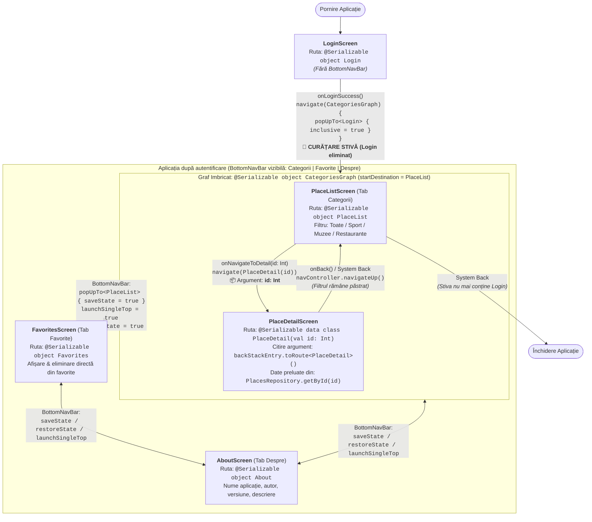

# Ghidul Maramureșului — Obiective Turistice (CMO · Laboratorul 05)

Aplicație Android nativă dezvoltată în **Kotlin** cu **Jetpack Compose**, **Material 3** și **Jetpack Compose Navigation (Nav2)** cu rute **type-safe (`@Serializable`)**.

---

## 1. Descriere generală

**Ghidul Maramureșului** este o aplicație de tip ghid turistic care prezintă **12 obiective turistice din județul Maramureș**, împărțite în 3 categorii principale:
- **Muzee** (4 obiective)
- **Sport** (4 obiective)
- **Restaurante** (4 obiective)

Accentul arhitectural cade pe **fluxul de navigare cu Jetpack Compose Navigation (Nav2)**:
1. **Rute type-safe (`@Serializable`)** — fără rute definite ca șiruri de caractere (`String`).
2. **Transmiterea argumentelor de navigare** — ecranul de detaliu primește doar `id`-ul locului prin `data class PlaceDetail(val id: Int)`, citit în destinație cu `backStackEntry.toRoute<PlaceDetail>()`, iar restul datelor sunt preluate din sursa unică `PlacesRepository`.
3. **Gestionarea stivei la autentificare (`Back Stack`)** — după autentificare se curăță ecranul `Login` din stivă folosind `popUpTo<Login> { inclusive = true }`, astfel încât apăsarea pe butonul **Back** din ecranul principal închide aplicația și nu revine la autentificare.
4. **Graf imbricat (`navigation<CategoriesGraph>`)** — ecranele `PlaceList` și `PlaceDetail` sunt grupate în graful imbricat `CategoriesGraph`, menținând tab-ul **Categorii** selectat și atunci când utilizatorul vizualizează detaliile unui obiectiv și păstrând starea stivei fiecărui tab (`saveState = true`, `restoreState = true`, `launchSingleTop = true`).
5. **Ecrane decuplate de navigare (`State Hoisting`)** — niciuna dintre funcțiile `@Composable` ale ecranelor (`LoginScreen`, `PlaceListScreen`, `PlaceDetailScreen`, `FavoritesScreen`, `AboutScreen`) nu primește `NavController` ca parametru; evenimentele de navigare sunt expuse prin funcții lambda (`onLoginSuccess`, `onNavigateToDetail`, `onBack`).

---

## 2. Modul de rulare

### Cerințe preliminare
- **Android Studio** (compatibil cu AGP `9.4.1`, Kotlin `2.2.10`, JDK 17/21+)
- **Android SDK** cu `compileSdk = 37` și `minSdk = 26` (Android 8.0+)
- Emulator Android sau dispozitiv fizic cu USB Debugging activat

### Pași pentru rulare în Android Studio
1. Clonați sau deschideți acest repository în **Android Studio** (`File` → `Open...` → selectați folderul proiectului).
2. Așteptați finalizarea procesului de **Gradle Sync**.
3. Selectați un emulator sau un dispozitiv fizic din bara de sus și apăsați **Run 'app'** (`Shift + F10`).
4. În ecranul de **Login**, introduceți orice nume de utilizator și orice parolă nevide (de ex. `student` / `1234`) și apăsați butonul **Intră**.

### Rulare din linia de comandă
```bash
# Compilare APK Debug
./gradlew assembleDebug

# Rulare teste unitare pentru PlacesRepository
./gradlew testDebugUnitTest
```

---

## 3. Diagrama fluxului de navigare

### Diagramă Mermaid (Ecrane, Tranziții, Argumente și Curățarea Stivei)



### Diagramă ASCII a fluxului și stivei (Back Stack)

```text
[Pornire]
   │
   ▼
┌──────────────────────────────────────────────────────────┐
│  LoginScreen (@Serializable object Login)                │
│  • BottomNavBar: ASCUNSĂ                                 │
│  • Buton „Intră” activ doar când user & parolă != ""     │
└──────────────────────────────────────────────────────────┘
   │
   │  navigate(CategoriesGraph) {
   │      popUpTo<Login> { inclusive = true }   <-- [CURĂȚARE STIVĂ: Login este scos din Back Stack]
   │  }
   ▼
╔══════════════════════════════════════════════════════════╗
║  Bara de navigare inferioară (BottomNavBar - 3 tab-uri)  ║
║  Opțiuni: popUpTo<PlaceList> { saveState = true }        ║
║           launchSingleTop = true, restoreState = true    ║
╠══════════════════╦═══════════════════╦═══════════════════╣
║  [1. Categorii]  ║   [2. Favorite]   ║    [3. Despre]    ║
╚════════╤═════════╩═════════╤═════════╩═════════╤═════════╝
         │                   │                   │
         ▼                   ▼                   ▼
┌─────────────────┐ ┌─────────────────┐ ┌─────────────────┐
│ CategoriesGraph │ │ FavoritesScreen │ │   AboutScreen   │
│  ┌───────────┐  │ │  object         │ │  object About   │
│  │ PlaceList │  │ │  Favorites      │ └─────────────────┘
│  └─────┬─────┘  │ └─────────────────┘
│        │        │
│   Argument:     │
│   id: Int       │
│        ▼        │
│  ┌───────────┐  │
│  │PlaceDetail│  │  <-- Citire argument: backStackEntry.toRoute<PlaceDetail>().id
│  │ (id: Int) │  │  <-- Back (TopAppBar / Sistem): navController.navigateUp() -> PlaceList
│  └───────────┘  │
└─────────────────┘
```

### Tabelul rutelor Type-Safe (`Routes.kt`)

| Rută (`@Serializable`) | Tip | Părinte | Argumente | Descriere |
| :--- | :--- | :--- | :--- | :--- |
| `Login` | `object` | `NavHost` (Root) | — | Ecranul de autentificare; eliminat din stivă după login cu `popUpTo<Login> { inclusive = true }`. |
| `CategoriesGraph` | `object` | `NavHost` (Root) | — | Graf imbricat pentru tab-ul **Categorii** (`startDestination = PlaceList`). |
| `PlaceList` | `object` | `CategoriesGraph` | — | Lista obiectivelor turistice (`LazyColumn`) cu filtrare `FilterChip` pe categorii. |
| `PlaceDetail(val id: Int)` | `data class` | `CategoriesGraph` | `id: Int` | Detaliile unui obiectiv citite din `PlacesRepository.getById(id)` + adăugare/eliminare favorite. |
| `Favorites` | `object` | `NavHost` (Root) | — | Lista obiectivelor favorite, cu posibilitate de eliminare directă și mesaj pentru listă goală. |
| `About` | `object` | `NavHost` (Root) | — | Informații despre aplicație, autor, versiune și descriere. |

---

## 4. Datele aplicației (`PlacesRepository.kt`)

Toate datele sunt stocate într-o singură sursă în cod (`object PlacesRepository`), conținând **12 obiective turistice** (câte 4 în fiecare categorie obligatorie):

| ID | Categorie | Obiectiv | Localitate |
| :-: | :--- | :--- | :--- |
| 1 | **Muzee** | Muzeul Satului Maramureșean | Sighetu Marmației |
| 2 | **Muzee** | Memorialul Victimelor Comunismului și al Rezistenței | Sighetu Marmației |
| 3 | **Muzee** | Muzeul Județean de Istorie și Arheologie Maramureș | Baia Mare |
| 4 | **Muzee** | Muzeul de Mineralogie „Victor Gorduza” | Baia Mare |
| 5 | **Sport** | Domeniul schiabil Cavnic | Cavnic |
| 6 | **Sport** | Stațiunea Borșa (schi, drumeții) | Borșa |
| 7 | **Sport** | Parcul Național Munții Rodnei (trasee montane) | Borșa / Moisei |
| 8 | **Sport** | Stațiunea Izvoare și Vârful Igniș (drumeții, schi) | Baia Mare / Desești |
| 9 | **Restaurante** | Restaurant Castel Transilvania | Baia Mare |
| 10 | **Restaurante** | Păstrăvăria Alex | Mara (Desești) |
| 11 | **Restaurante** | Casa Iurca de Călinești | Sighetu Marmației |
| 12 | **Restaurante** | Restaurant Bizo (Centrul Istoric) | Baia Mare |

---

## 5. Capturi de ecran (`screenshots/`)

Capturile de ecran ale aplicației se regăsesc în directorul [`screenshots/`](screenshots/):
- `01_login.png` — Ecranul de autentificare (Login)
- `02_categorii_toate.png` — Lista locurilor (filtru: **Toate**)
- `03_categorii_sport.png` — Lista locurilor (filtru: **Sport**)
- `04_categorii_muzee.png` — Lista locurilor (filtru: **Muzee**)
- `05_categorii_restaurante.png` — Lista locurilor (filtru: **Restaurante**)
- `06_detaliu_loc.png` — Ecranul de detaliu al unui obiectiv turistic
- `07_favorite.png` — Ecranul cu obiectivele marcate ca favorite
- `08_despre.png` — Ecranul Despre aplicație
